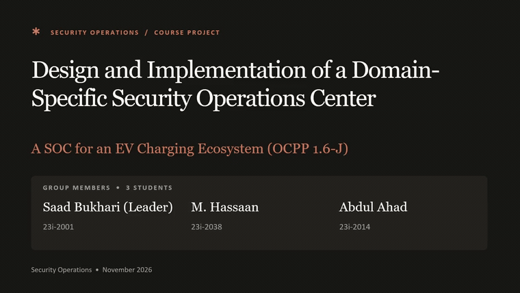

# EV Charging Ecosystem SOC (OCPP 1.6-J)

A prototype Security Operations Center for a public EV charging site. Eight simulated chargers talk OCPP 1.6-J over WebSocket to a Charging Station Management System (CSMS). The project generates normal operation, injects three controlled attacks, captures packets and logs, and detects the attacks with Wireshark/tshark and Splunk.

**Team**

| Name | Student ID | Role |
|---|---|---|
| Saad Bukhari | 23i-2001 | Simulation Lead |
| M. Hassaan | 23i-2038 | Attack Generation Lead |
| Abdul Ahad | 23i-2014 | Detection Lead |

The full write-up is in [docs/EV_SOC_Report.docx](docs/EV_SOC_Report.docx). A live, deployed version of this project, with a real OCPP server, a working attack console and a SOC dashboard, lives in [webapp/](webapp/) (README: [webapp/README.md](webapp/README.md)).

## Project overview video

A two-minute walkthrough of the project: the problem, the architecture, the three attacks, and the results.



The GIF above is a short excerpt (GitHub does not auto-play an `.mp4` committed directly to the repo, only files uploaded through its own drag-and-drop attachment flow). Watch the full two-minute video: [webapp/docs/media/demo.mp4](webapp/docs/media/demo.mp4) (download, 2.1 MB).

## Overview

| Item | Detail |
|---|---|
| Protocol | OCPP 1.6-J over WebSocket (`ws://10.10.20.10:8080/ocpp/<ChargePointId>`) |
| Assets | 8 chargers (2x AC 7.4 kW, 4x AC 22 kW, 2x DC 50 kW) and one CSMS |
| Simulation | Two hours of traffic, deterministic (seed 1337), 97,440 packets, about 16.5k log events |
| Attacks | A1 authentication brute force, A2 rogue charger impersonation, A3 connection flood |
| SIEM | Splunk Enterprise (deployed and verified live); equivalent Wazuh rules included as an alternative |
| Result | 19 alerts, all attributable to the injected attacks, 0 false positives |

## Attack scenarios

| ID | Scenario | Window (UTC) | Main indicators |
|---|---|---|---|
| A1 | WebSocket password brute force and RFID idTag guessing | 08:38 to 08:49 | Bursts of HTTP 401 from one non-charger IP, many rejected idTags, then a success |
| A2 | Rogue CP-03 session with fraudulent transactions | 09:05 to 09:15 | Duplicate session, firmware/serial mismatch, power up to 8.4x rating, energy rollback, unknown-vendor DataTransfer |
| A3 | Handshake and BootNotification flood | 09:38 to 09:46 | Order-of-magnitude jump in handshakes, HTTP 503, CPU and latency growth, ping-timeout disconnects |

## Repository layout

| Path | Contents |
|---|---|
| `sim/` | Simulator: topology, normal behaviour, attack scenarios, packet and log generation |
| `output/pcap/` | Full and per-attack packet captures (open in Wireshark) |
| `output/logs/csms/` | CSMS JSON logs (`ocpp_gateway.log`, `transactions.log`, `system.log`) |
| `output/ground_truth/` | Attack windows and per-event labels, used only for scoring |
| `output/evidence/` | tshark evidence per scenario |
| `output/siem/` | Alerts and evaluation results |
| `output/dashboard/` | Detection engine dashboard (`dashboard.html`) |
| `siem/splunk/` | Splunk app (index, lookup, saved searches, dashboard) and `queries.spl` |
| `siem/wazuh/` | Wazuh rule set and CDB list (alternative implementation, not used for this submission) |
| `siem/detect.py` | Independent Python detection engine with scored evaluation |
| `siem/dashboard.py`, `siem/replay.py` | Dashboard builder and accelerated log replay |
| `analysis/` | Wireshark/tshark evidence script |
| `docs/` | Report, diagrams, screenshots and report build scripts |
| `run_all.sh` | One-command reproduction of the full pipeline |

## Quick start

Requirements: Python 3, `scapy`, `pandas`, `matplotlib`, `python-docx`, and `tshark`.

```bash
./run_all.sh
```

This takes about three minutes and runs, in order: simulation, detection engine, dashboard, Wireshark evidence, diagrams, and report build. Individual steps:

```bash
python3 sim/generate.py       # logs, pcaps, ground truth
python3 siem/detect.py        # alerts and evaluation
python3 siem/dashboard.py     # output/dashboard/dashboard.html
bash analysis/wireshark_evidence.sh
```

Note: `run_all.sh` regenerates `docs/EV_SOC_Report.docx` from `docs/report.md` using `docs/build_report.py`, which overwrites a manually formatted copy of the report.

## Wireshark analysis

Open any file in `output/pcap/` in Wireshark. TCP/8080 is dissected as HTTP and then WebSocket, and OCPP-J appears as `websocket.payload.text`. Example display filters:

| Purpose | Filter |
|---|---|
| A1 failed logins | `http.response.code==401 && ip.dst==10.10.99.66` |
| A1 plaintext credentials | `http.authbasic && ip.src==10.10.99.66` |
| A2 duplicate session | `http.request.uri contains "/ocpp/CP-03"` |
| A2 absurd power | `websocket.payload.text contains "Power.Active" && ip.src==10.10.99.66` |
| A3 SYN flood | `tcp.flags.syn==1 && tcp.flags.ack==0 && ip.src==10.10.99.66` |
| A3 saturation | `http.response.code==503` |

The complete filter table is in section 6 of the report.

## Splunk deployment

The Splunk app in `siem/splunk/ev_soc_app` defines index `ev_soc`, JSON field extraction, a charger inventory lookup, five saved searches and the "EV Charging SOC" dashboard.

| Setting | Value |
|---|---|
| Install path | `/opt/splunk` (app at `/opt/splunk/etc/apps/ev_soc`) |
| Web UI | `http://localhost:8000` |
| Monitored data | `/opt/splunk_data/ev_soc/` |
| Indexed events | 16,559 |

All five saved searches were executed through the Splunk REST API against the live index and each fired on the correct attack. Exact results are in section 7 of the report. Splunk credentials are not stored in this repository.

## Detection results

| Scenario | First alert (UTC) | Time to detect | Indicator recall |
|---|---|---|---|
| A1 brute force | 08:38:30 | 30 s | 4/4 rules |
| A2 rogue charger | 09:05:00 | under 1 s | 7/7 rules |
| A3 flood | 09:38:02 | 2.4 s | 5/5 rules |

The data is synthetic and the attacks are scripted, so perfect recall and zero false positives reflect a clean lab and not production performance. See section 8 of the report for limitations.

## Screenshots

`docs/screenshots/` holds ten screenshots: five from the Wireshark GUI and five from the live Splunk web UI. They are generated by `docs/capture_screenshots.sh`, which needs `SPLUNK_ADMIN_PASSWORD` set, Xvfb and chromedriver.
