# Demo Preparation Guide: EV Charging Ecosystem SOC (OCPP 1.6-J)

Prepared by Saad Bukhari (23i-2001), M. Hassaan (23i-2038) and Abdul Ahad (23i-2014).

Also available as a Word document: [EV_SOC_Demo_Guide.docx](EV_SOC_Demo_Guide.docx).

## 1. How to use this guide

This guide is for the three of us. It explains the whole project in simple words, from "what is an EV charger talking to?" to "why did the alert fire at 08:38:30?", so that any of us can present or answer questions on any part. Read sections 2 to 7 once, then use sections 9 to 12 for the demo itself.

| If you have | Read |
|---|---|
| 10 minutes | Section 2 (the project in one page) and Section 12 (cheat sheet) |
| 30 minutes | Sections 2 to 6, then Section 9 (demo script) |
| One evening | Everything, then practise the demo once end to end with a timer |

> Golden rule for the demo: every claim should be backed by something on screen (a packet, a log line, a Splunk result, or an alert). If we say "the attacker brute-forced the password", we show the 401 packets.

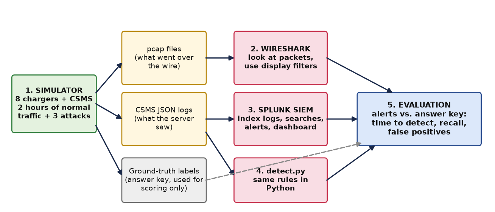

## 2. The project in one page

**What we built.** A small Security Operations Center (SOC) for a public EV charging site. A SOC is a team and a set of tools that watch a system, spot attacks, and raise alerts. Ours watches eight chargers and the server that manages them.

**How it works, in five steps.**

1. A **simulator** produces two hours of realistic traffic between 8 chargers and the central server (the CSMS). It writes two kinds of evidence: packet captures (pcap files) and server logs (JSON).
2. The simulator also injects **three attacks** (A1, A2, A3) at known times.
3. We analyse the packets with **Wireshark / tshark**.
4. We load the logs into **Splunk** (our SIEM) and run searches that raise alerts.
5. A Python engine, **detect.py**, repeats the same rules and compares its alerts to the answer key (the ground truth) to measure how good the detection is.

**Why it matters.** EV chargers are internet-connected devices that handle money and sit on the electric grid. The protocol they use (OCPP) has no built-in security unless TLS is added, so attacks are realistic.

**Headline results.** 19 alerts, all 19 caused by the injected attacks, 0 false positives. First alert came 30 seconds after A1 started, immediately for A2, and 2.4 seconds after A3 started.

## 3. EV charging basics

| Term | Plain meaning |
|---|---|
| EVSE / charger / charge point | The box you plug the car into. Ours are named CP-01 to CP-08. |
| CSMS | Charging Station Management System: the central server that every charger reports to. It decides who may charge and does the billing. |
| OCPP | Open Charge Point Protocol: the common language chargers and the CSMS use. We use version 1.6-J (J means JSON over WebSocket). |
| RFID card / idTag | The card a driver taps. The card has an ID (idTag). The charger asks the CSMS if that ID is allowed. |
| Transaction | One charging session, from start to stop. |
| Meter value | A reading from the charger: power in watts, energy in watt-hours. |
| SIEM | Security Information and Event Management: a tool (Splunk here) that collects logs and raises alerts. |
| SPAN port | A switch port that copies all traffic to a monitoring device. That is where our packet capture comes from. |

**Everyday analogy.** Think of each charger as a shop till and the CSMS as head office. The till phones head office when it opens (BootNotification), says "I am still here" every minute (Heartbeat), checks if a customer's card is valid (Authorize), and reports how much was sold (MeterValues). Our attacks are: someone guessing the till's password (A1), someone pretending to be a till and reporting fake sales (A2), and someone calling head office so many times that real tills cannot get through (A3).

## 4. How the protocol works

### 4.1 The layers

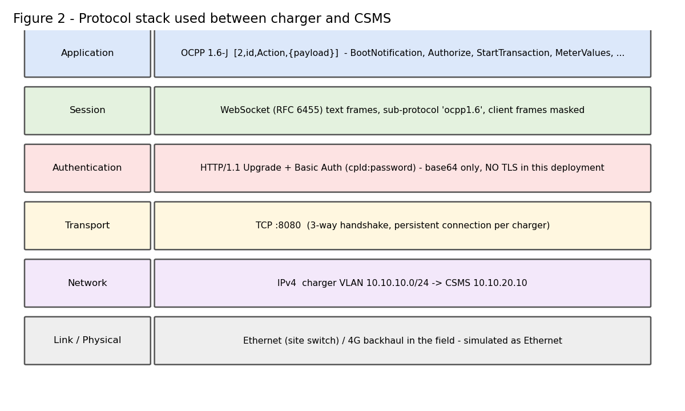

Reading the picture from the bottom up: Ethernet and IP carry packets across the site. TCP gives a reliable connection to port 8080 on the server. On top of TCP the charger sends an HTTP request that asks to "upgrade" to a WebSocket and includes a username and password (HTTP Basic authentication). Once upgraded, the connection stays open and both sides send small JSON messages. Those JSON messages are OCPP.

**Why WebSocket?** A charger may sit behind a router and cannot be reached from outside. So the charger opens the connection to the server, and the server then sends commands back down the same open connection.

### 4.2 One charger from power-on to a finished charge

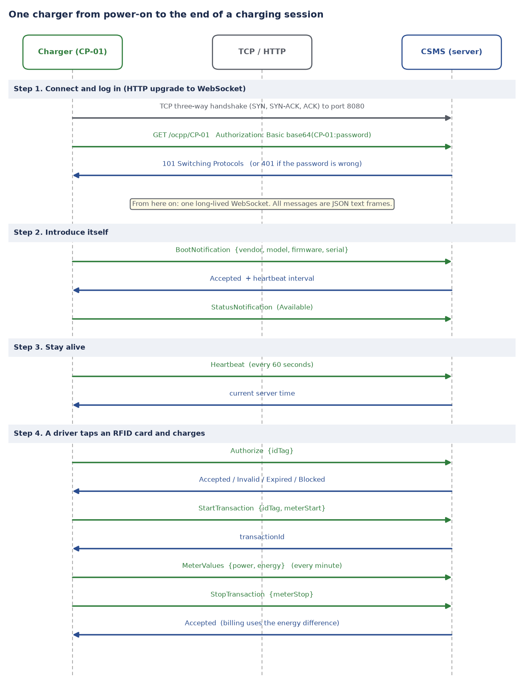

Walk through it in four steps:

1. **Connect and log in.** TCP handshake, then an HTTP GET to `/ocpp/CP-01` with the header `Authorization: Basic base64(CP-01:password)`. If the password is right the server answers `101 Switching Protocols`. If wrong, `401 Unauthorized`. If the server is overloaded, `503`.
2. **Introduce itself.** BootNotification carries the vendor, model, firmware version and serial number. The server replies Accepted. The charger then reports its status (Available).
3. **Stay alive.** A Heartbeat every 60 seconds. If heartbeats stop, the server marks the charger offline (we log this as `ping_timeout`).
4. **Charge.** The driver taps a card: Authorize, then StartTransaction (with the starting meter reading), then MeterValues every minute, then StopTransaction (with the final meter reading). Billing is based on the difference between the two meter readings.

### 4.3 What a message looks like

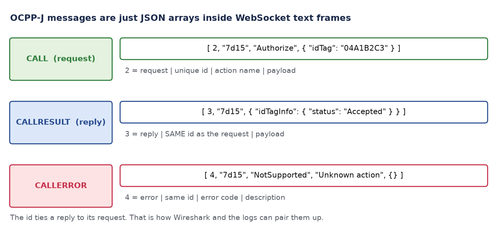

Every message is a JSON array. The first number says what it is: 2 is a request (CALL), 3 is a reply (CALLRESULT), 4 is an error. The second item is a unique id so a reply can be matched to its request. Example of a real request on the wire:

`[2,"7d15","Authorize",{"idTag":"04A1B2C3"}]`

### 4.4 The messages that matter for our attacks

| Message | Sent by | What it means | Where we use it |
|---|---|---|---|
| BootNotification | Charger | "I am here, this is my firmware and serial." | A2: rogue charger reports firmware 9.9.9-dev. A3: flood uses random serials. |
| StatusNotification | Charger | "My connector is Available / Preparing / Charging." | Normal behaviour baseline |
| Heartbeat | Charger | "Still alive." Every 60 s. | A3: real chargers stop being answered |
| Authorize | Charger | "Is this card allowed?" Answer: Accepted, Invalid, Expired or Blocked. | A1: card guessing |
| StartTransaction | Charger | "Charging started, meter reads X." | A2: meterStart = 0 is suspicious |
| MeterValues | Charger | Power and energy readings. | A2: 150 to 185 kW on a 22 kW charger |
| StopTransaction | Charger | "Charging ended, meter reads Y." | A2 |
| DataTransfer | Either | Vendor-specific custom message. | A2: probing an unknown vendor "x-diag" |

### 4.5 Why this deployment is weak (and why the attacks work)

| Weakness | What it allows | Attack |
|---|---|---|
| No TLS: everything is plaintext | Anyone on the network can read the Basic-auth password and the meter data | A1, A2 |
| Weak, guessable per-charger passwords | Brute force succeeds after about 53 tries | A1 |
| Nothing ties a charger ID to its IP address or hardware | A second device can log in as CP-03 | A2 |
| Duplicate sessions for the same ID are accepted | The rogue and the real CP-03 are online together | A2 |
| Server does not check readings for plausibility | 184 kW on a 22 kW charger, and energy going backwards, are accepted | A2 |
| No limit on connection attempts before login | The server can be flooded | A3 |

## 5. Our system

### 5.1 The network

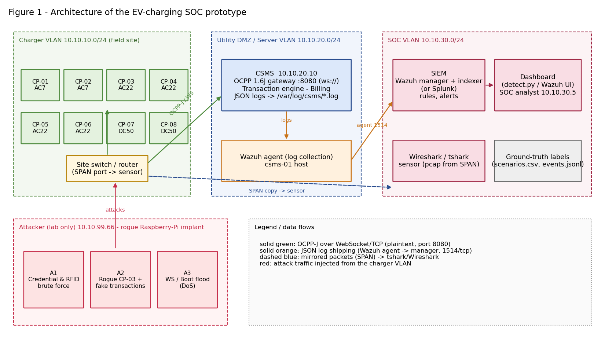

There are three zones. The **charger VLAN** (10.10.10.0/24) holds the eight chargers, .11 to .18. The **server VLAN** (10.10.20.0/24) holds the CSMS at 10.10.20.10, port 8080, which writes three JSON logs. The **SOC VLAN** (10.10.30.0/24) holds the SIEM, the dashboard, the analyst workstation and the tshark sensor, which receives a copy of the traffic from a SPAN port. The attacker (10.10.99.66) sits on the charger VLAN, as if someone had plugged a small device into a charger cabinet.

The eight chargers are: CP-01 and CP-02 (AC 7.4 kW), CP-03 to CP-06 (AC 22 kW), CP-07 and CP-08 (DC 50 kW).

### 5.2 The three data sources

| Source | Where | What it tells us |
|---|---|---|
| Packets | `output/pcap/ev_soc_full.pcap` (97,440 frames) plus one pcap per attack | The raw truth on the wire: logins, JSON messages, SYN packets |
| CSMS logs | `output/logs/csms/` | `ocpp_gateway.log` (logins, messages, disconnects), `transactions.log` (authorize, start, stop, meter values), `system.log` (15-second health, admin logins) |
| Ground truth | `output/ground_truth/` | The answer key: when each attack ran and every attacker event. The detector never reads it, we only use it to score results. |

### 5.3 How the simulator works

The simulator is in `sim/` and is deterministic (seed 1337), so every run gives the same data. It schedules events in time order. For each OCPP message it does two things: it builds the real packets with scapy (TCP handshake, HTTP upgrade with a correct `Sec-WebSocket-Accept`, masked WebSocket frames), and it writes the matching JSON log record. That is why the pcap opens in Wireshark as real HTTP and WebSocket traffic.

| File | Role |
|---|---|
| `sim/topology.py` | Chargers, IPs, ratings, inventory |
| `sim/world.py` | Builds packets and logs for each message |
| `sim/scenarios.py` | Normal behaviour and the three attacks |
| `sim/generate.py` | Runs everything and writes `output/` |

**Normal behaviour:** 8 persistent connections, BootNotification and StatusNotification on connect, Heartbeat every 60 s, 3 to 4 charging sessions per charger. The normal power-to-rating ratio is mean 0.53 and max 0.97, and energy registers continue across sessions.

**Harmless noise on purpose** (to prove we do not raise false alarms): an invalid card (CP-02, 08:15), a wrong password after maintenance (CP-04, 08:25), an admin login failure then success (08:58), an expired card (CP-06, 09:10), a blocked card (CP-01, 09:52).

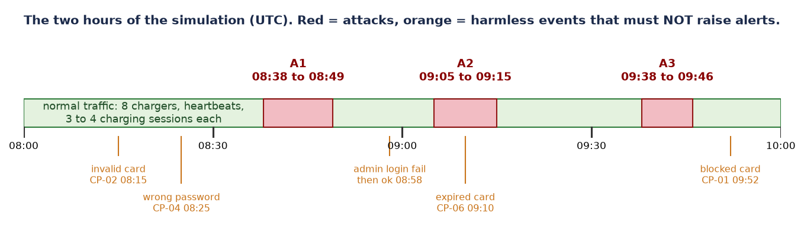

### 5.4 How a log line matches a packet

Each log event comes from a layer of the stack, and we can find the same fact in Wireshark. This is how we cross-check.

| Log event | Layer | Wire evidence |
|---|---|---|
| `ws_auth` | TCP, HTTP Upgrade, Basic auth | SYN, `http.request.uri`, `http.authbasic`, response code 101/401/503 |
| `ocpp_message` | OCPP over WebSocket | `websocket.payload.text` with `[2,id,"Action",{...}]` |
| `cp_boot`, `cp_status` | Specific OCPP actions | The same WebSocket frame, read further |
| `id_authorize`, `transaction_*`, `meter_value` | Billing-related OCPP actions | JSON payloads, tied together by transaction id |
| `cp_disconnected` | WebSocket and TCP close | FIN or RST after missed heartbeats |
| `service_health` | Server-side summary | Derived from SYN volume and response latency |

## 6. The three attacks, explained simply

All three come from 10.10.99.66 with the user-agent `python-websockets/12.0`. Real chargers use `CT-Firmware/2.4.1`, which is itself a useful clue.

### 6.1 A1: authentication brute force (08:38 to 08:49)

**Story.** The attacker does not know any charger password, so they guess. Then they target the RFID system.

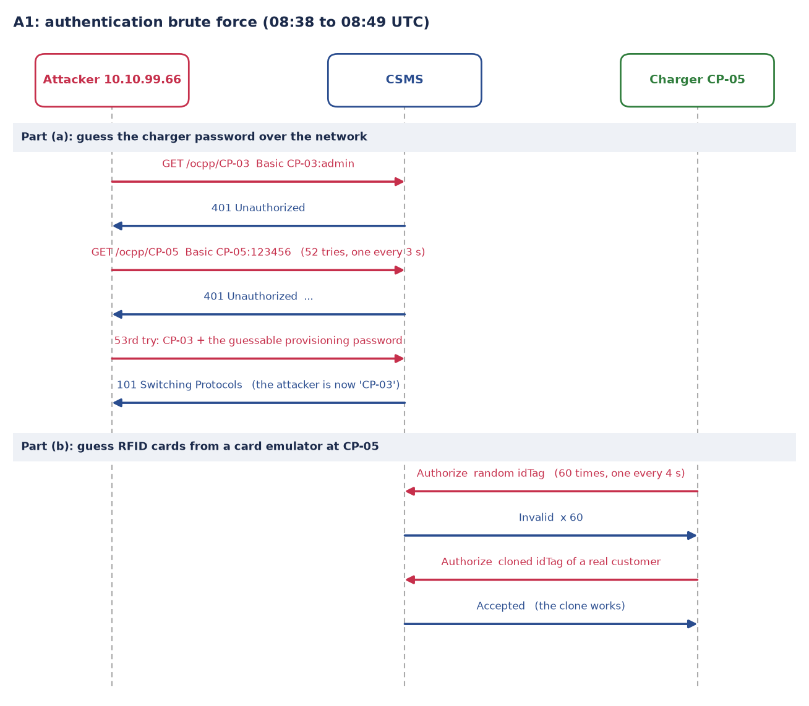

**Part (a), password guessing.** 52 WebSocket login attempts, one every 2.5 to 4 seconds, using a 13-word dictionary across CP-01 to CP-10 (two of those IDs do not exist). The 53rd attempt works for CP-03 because the provisioning password is predictable.

**Part (b), card guessing.** At 08:44 a card emulator held to CP-05 sends 60 random idTags, all Invalid, then one Accepted: the cloned card of a real customer who is charging at CP-07.

**How we see it.**

| Where | What |
|---|---|
| Wireshark | Many HTTP 401 replies to 10.10.99.66, then a 101. Base64 passwords decode in clear. 61 Authorize messages at CP-05, 60 Invalid then one Accepted. |
| Splunk | 2-minute bins with 37 and 15 failures (threshold 10). 29 rejected Authorize per bin at CP-05. |
| Rules | 100110 (login brute force), 100111 (login from a wrong IP), 100112 (idTag guessing), 100113 (idTag accepted after a burst) |

**Baseline for comparison:** the normal two hours contain only one 401 and three rejected cards, so 10 failures in 2 minutes is clearly abnormal.

### 6.2 A2: rogue charger with fraudulent transactions (09:05 to 09:15)

**Story.** Using the CP-03 password learned in A1, the attacker logs in as CP-03 from a different device while the real CP-03 is still online. They pretend to be a charger that gives away power and reports false numbers.

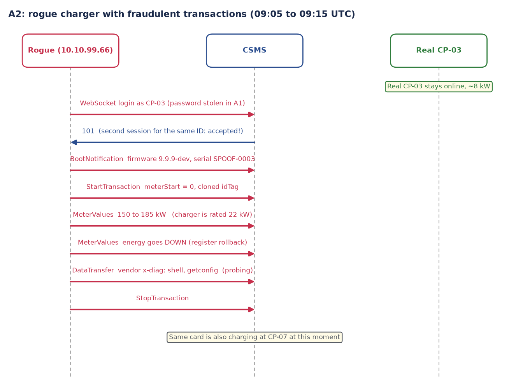

**What they send.** BootNotification with firmware `9.9.9-dev` and serial `SPOOF-0003`. A cloned card is authorised. StartTransaction with `meterStart=0` (the real register is in the hundreds of kWh). 16 MeterValues at 30-second intervals reporting 150 to 185 kW on a 22 kW charger (up to 8.4 times the rating). One energy rollback (energy goes down). Two DataTransfer probes to vendor `x-diag` (`shell`, `getconfig`). StopTransaction. Meanwhile the real owner of the card is charging at CP-07.

**How we see it.**

| Where | What |
|---|---|
| Wireshark | Two sessions for `/ocpp/CP-03`: one from 10.10.10.13, one from 10.10.99.66. Power values 155 to 184 kW from the rogue against about 8 kW from the real one. Two DataTransfer frames. |
| Splunk | CP-03 session from 10.10.99.66 (663 messages). Firmware 9.9.9-dev. Max power 184,061 W. |
| Rules | 100111 (IP not registered), 100120 (firmware or serial), 100121 (power above 1.2 times rating), 100122 (energy decreased), 100123 (unknown vendor DataTransfer), 100124 (meterStart is 0), 100125 (same idTag at two chargers) |

### 6.3 A3: connection and BootNotification flood (09:38 to 09:46)

**Story.** The attacker overloads the server so legitimate chargers cannot stay connected. This is a denial of service.

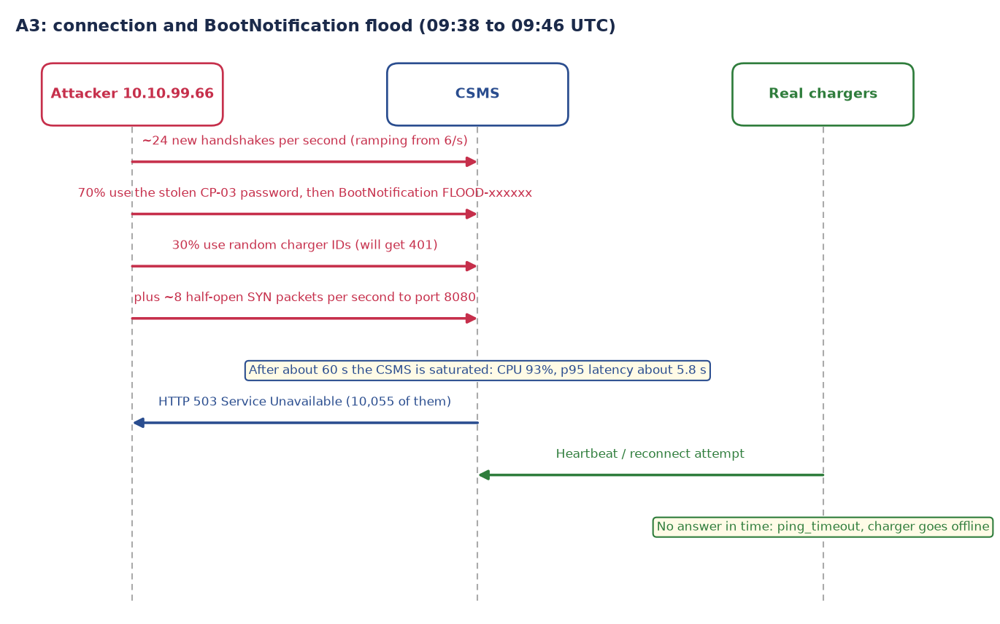

**What they do.** About 24 new handshakes per second (ramping up from 6 per second over the first minute). 70 percent use the stolen CP-03 password and then send BootNotifications with random serials (`FLOOD-xxxxxx`). 30 percent use random IDs and get 401. On top of that, about 8 half-open SYN packets per second to port 8080.

**What happens.** After about 60 seconds the simulated CSMS saturates. It answers 503, the 95th percentile latency climbs to about 5.8 seconds, real chargers time out and drop offline, and they cannot reconnect until the flood ends.

**How we see it.**

| Where | What |
|---|---|
| Wireshark | 14,856 SYNs from the attacker against 40 from all chargers in the window. 10,055 HTTP 503 responses. |
| Splunk | 570 to 770 handshakes per 30 seconds from 10.10.99.66, sixteen bins in a row. Disconnects on CP-02, CP-03, CP-05, CP-06. Peak CPU 99 percent, peak WebSockets 669 (normal is 8). |
| Rules | 100130 (100 or more handshakes in 30 s per IP), 100131 (20 or more 503 per minute), 100132 (3 or more ping-timeouts in 3 minutes), 100133 (CPU 90 percent or more), 100135 (20 or more BootNotifications in 30 s per IP) |

## 7. How we detect attacks

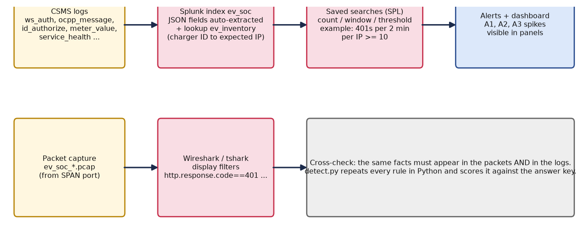

### 7.1 Wireshark and tshark

Open any pcap in Wireshark. TCP port 8080 is decoded as HTTP, then WebSocket, and the OCPP JSON shows as `websocket.payload.text`. A display filter hides everything except what we want.

| Purpose | Display filter |
|---|---|
| A1 failed logins | `http.response.code==401 && ip.dst==10.10.99.66` |
| A1 plaintext passwords | `http.authbasic && ip.src==10.10.99.66` |
| A1 card guessing | `ip.src==10.10.10.15 && websocket.payload.text contains "Authorize"` |
| A2 duplicate session | `http.request.uri contains "/ocpp/CP-03"` |
| A2 absurd power | `websocket.payload.text contains "Power.Active" && ip.src==10.10.99.66` |
| A2 probing | `websocket.payload.text contains "DataTransfer"` |
| A3 SYN flood | `tcp.flags.syn==1 && tcp.flags.ack==0 && ip.src==10.10.99.66` |
| A3 saturation | `http.response.code==503` |

The same filters work on the command line with `tshark -r <file.pcap> -Y "<filter>"`. The script `analysis/wireshark_evidence.sh` runs them all and saves the output to `output/evidence/`.

### 7.2 Splunk

The Splunk app `siem/splunk/ev_soc_app` contains: index `ev_soc`, JSON field extraction (`props.conf`), a lookup `ev_inventory.csv` that maps each charger ID to its registered IP, five saved searches, and the "EV Charging SOC" dashboard. Logs sit in a monitored folder and are indexed automatically (16,559 events).

The five saved searches, in plain words:

| Search | Idea |
|---|---|
| A1 WS brute force | `ws_auth` failures, grouped in 2-minute bins per source IP, alarm at 10 or more |
| A1 RFID guessing | rejected `id_authorize`, 2-minute bins per charger, alarm at 10 or more |
| A2 session from unregistered IP | successful logins whose source IP differs from the inventory lookup |
| A2 implausible power | `meter_value` where power is over 1.2 times the charger rating |
| A3 connection flood | `ws_auth` events in 30-second bins per source IP, alarm at 100 or more |

A typical search, so we can explain it line by line:

`index=ev_soc event=ws_auth result=failure | bin _time span=2m | stats count dc(cp_id) as ids by _time src_ip | where count>=10`

Read it as: take failed logins, cut time into 2-minute buckets, count failures and distinct charger IDs per source IP in each bucket, and keep only buckets with 10 or more.

**Timezone warning.** Splunk's web interface shows local time (UTC-5), so an 08:38 UTC attack shows as 03:38. The underlying data is correct. Say this before someone asks.

### 7.3 detect.py

`siem/detect.py` implements the same rule set in pandas, runs it over the logs, and then compares every alert with the ground truth. It writes `output/siem/alerts.csv` and `evaluation.json`. It exists so that we have a second, independent confirmation and a number for time to detect, recall and false positives. `siem/dashboard.py` builds a static HTML dashboard from the results.

### 7.4 The rule set

| Rule | Logic | Attack |
|---|---|---|
| 100110 | 10 or more failed handshakes in 2 min per source IP | A1 |
| 100111 | Successful login from an IP not registered for that charger ID | A1, A2, A3 |
| 100112, 100113 | 10 or more rejected idTags in 2 min per charger, then one Accepted | A1 |
| 100120 | BootNotification firmware not 2.4.1 | A2 |
| 100121 | Power above 1.2 times rated | A2 |
| 100122 | Energy register went down | A2 |
| 100123 | DataTransfer to an unknown vendor | A2 |
| 100124 | StartTransaction with meterStart 0 | A2 |
| 100125 | Same idTag active at two chargers | A2 |
| 100130 | 100 or more handshakes in 30 s per IP | A3 |
| 100131 | 20 or more HTTP 503 per minute | A3 |
| 100132 | 3 or more ping-timeout disconnects in 3 min | A3 |
| 100133 | CSMS CPU 90 percent or more | A3 |
| 100135 | 20 or more BootNotifications in 30 s per IP | A3 |

### 7.5 Wazuh or Splunk?

The brief allows either. We used **Splunk**, installed and verified live. The Wazuh rules in `siem/wazuh/` express the same logic and are included as an alternative, but they were not the path we ran. Be honest about this if asked.

## 8. Results

| Scenario | First alert (UTC) | Time to detect | Indicator recall | Alerts |
|---|---|---|---|---|
| A1 brute force | 08:38:30 (rule 100110) | 30 s | 4 of 4 rules | 4 |
| A2 rogue charger | 09:05:00 (rule 100111) | under 1 s | 7 of 7 rules | 8 |
| A3 flood | 09:38:02 (rule 100135) | 2.4 s | 5 of 5 rules | 5 (7 with 100110 and 100111 from the same attacker) |

Overall: 19 alerts, all 19 attributable to the attacks, 0 false positives. The harmless events (3 rejected cards, 1 bad password, 1 admin failure) stayed under every threshold.

**Honest limitations (say these yourself before being asked).**

1. The data is synthetic and the attacks are scripted, so 100 percent recall and zero false positives are expected in a clean lab. They are not a claim about production.
2. Thresholds would need tuning on real traffic.
3. A patient "low and slow" brute force (fewer than 10 attempts per 2 minutes) would evade rules 100110 and 100112.
4. For A3, the fleet impact alert (100132) arrives about four minutes late, so the flood, 503 and CPU rules are the real early warnings.
5. The card-clone alert (100113) is confirmed about 3.5 minutes after the first A1 alert.

**Mitigations (what we recommend).** Use TLS with certificates (OCPP Security Profile 2 or 3). Use random, unique, long passwords with lock-out. Reject a second session for the same charger ID and pin ID to a certificate or IP. Check meter values on the server (above rated power, non-monotonic energy, wrong meterStart). Rate-limit Authorize and use cryptographic cards. Limit connections per IP and use SYN cookies. Use 802.1X port security and cabinet tamper alarms. Tie alerts to response playbooks.

## 9. Demo script

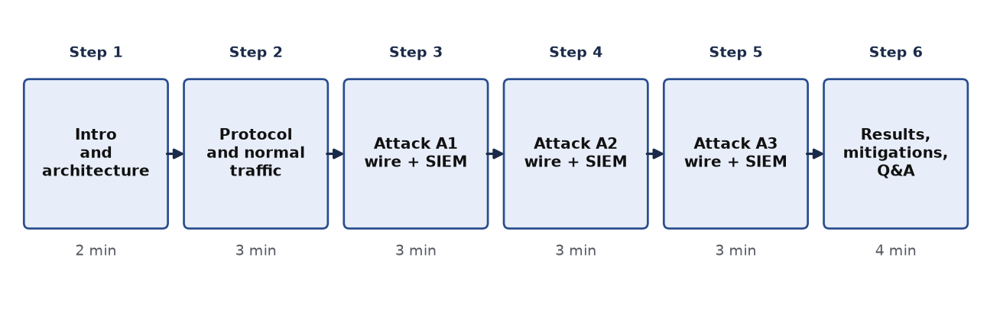

Total time about 18 minutes plus questions. Suggested speakers: the person who built that part presents it (Saad: steps 1 and 2, M. Hassaan: steps 3 to 5 attack side, Abdul Ahad: detection side and results). Everyone must still be able to answer anything.

### 9.1 Before the demo (checklist)

| Done | Item |
|---|---|
| [ ] | Splunk is running and searching `index=ev_soc` shows 16,559 events in total |
| [ ] | Splunk time range set to "All time" (the saved searches use earliest=0) |
| [ ] | Wireshark open with `output/pcap/ev_soc_A1.pcap`, A2 and A3 ready in the recent files list |
| [ ] | `output/dashboard/dashboard.html` open in a browser tab |
| [ ] | The report and the architecture figure open |
| [ ] | A terminal in the project folder, with `output/evidence/` files ready to show |
| [ ] | Backup: the screenshots in `docs/screenshots/` in case Splunk or Wireshark misbehaves |
| [ ] | Know the UTC vs UTC-5 difference in Splunk |
| [ ] | Rehearsed once with a timer |

### 9.2 Step by step

**Step 1 (2 min): Introduce the project and architecture.** Show the architecture figure. Say: eight chargers, one CSMS, a SOC that watches via a SPAN port and logs. Name the three attacks and the two detection tools.

**Step 2 (3 min): Protocol and normal traffic.** Show the lifecycle diagram. In Wireshark open `ev_soc_full.pcap` and apply `websocket.payload.text contains "BootNotification"` to show a real OCPP-J frame. Then `http.response.code==101` to show healthy logins. Say: this is the normal baseline, with one 401 and three rejected cards in two hours.

**Step 3 (3 min): Attack A1.** Open `ev_soc_A1.pcap`. Apply `http.response.code==401 && ip.dst==10.10.99.66` (52 packets in the A1 capture). Then `http.authbasic && ip.src==10.10.99.66` and expand a packet to show the password in clear. Then switch to Splunk and run the A1 saved search: bins at 08:38 and 08:40 above the threshold of 10. Mention the RFID part: 60 Invalid then one Accepted at CP-05.

**Step 4 (3 min): Attack A2.** Open `ev_soc_A2.pcap`. Apply `http.request.uri contains "/ocpp/CP-03"` and point out two sources. Apply the Power.Active filter and show 155 to 184 kW. In Splunk run the implausible power search (max 184,061 W) and the unregistered IP search (the lookup is the key idea).

**Step 5 (3 min): Attack A3.** Open `ev_soc_A3.pcap`. Apply the SYN filter and show the Statistics counts (14,856 SYNs from the attacker). Apply `http.response.code==503` (10,055). In Splunk run the flood search: sixteen consecutive 30-second bins above 100. Show the dashboard panel with CPU and active WebSockets spiking.

**Step 6 (4 min): Results and wrap-up.** Show the evaluation table and the dashboard. State the limitations ourselves. Close with the mitigations.

### 9.3 Useful commands

| Goal | Command |
|---|---|
| Rebuild everything | `./run_all.sh` (about 3 minutes) |
| Re-run detection only | `python3 siem/detect.py` |
| Show alerts | open `output/siem/alerts.csv` |
| Show scores | open `output/siem/evaluation.json` |
| List the 401 packets in a pcap | `tshark -r output/pcap/ev_soc_A1.pcap -Y "http.response.code==401"` (one line per packet) |
| Show attacker events | `output/ground_truth/events.jsonl` |

> Warning: `run_all.sh` rewrites `docs/EV_SOC_Report.docx` from the markdown source. Do not run it right before submission if you want to keep the formatted report.

## 10. Questions we should expect

| Question | Short answer |
|---|---|
| Is this real traffic? | No. It is simulated, but the pcap is built with real TCP, HTTP and WebSocket framing, so Wireshark decodes it as real traffic, and the logs match the packets. |
| Why simulate? | A real charging network is expensive and unsafe to attack. Simulation lets us control timing, repeat runs (fixed seed 1337) and know the ground truth. |
| What is a SIEM? | A system that collects logs from many sources, normalises them, runs detection rules and shows alerts and dashboards. We used Splunk. |
| Why Splunk and not Wazuh? | The brief allows either. Splunk gave us live searches and a dashboard we could verify through the REST API. Wazuh rules are included as an equivalent alternative but were not the path we ran. |
| Why does OCPP use WebSocket? | Chargers are usually behind NAT or cellular links and cannot accept inbound connections, so they open a persistent outbound connection that the server also uses to send commands. |
| Is the password really visible? | Yes. HTTP Basic is only base64 encoding, not encryption, and there is no TLS. Wireshark decodes it directly. |
| How did the attacker get CP-03's password? | A1 guessed it from a dictionary, because the provisioning password was predictable. A2 and A3 reuse it. |
| Why did A2 succeed with two CP-03 sessions? | The CSMS does not reject a duplicate session and does not tie an ID to an IP or certificate. That is the weakness, and rule 100111 detects it. |
| What is the difference between A1 part (a) and part (b)? | (a) guesses the network login password of a charger. (b) guesses driver RFID cards at a charger. Different layers, different rules. |
| What is the lookup in Splunk? | `ev_inventory.csv` maps each charger ID to its registered IP. A login from any other IP for that ID is flagged. |
| How did you pick thresholds? | From the baseline: normal traffic has at most one 401 and three rejected cards over two hours, so 10 in 2 minutes is far above normal. The flood threshold of 100 per 30 seconds is far above the normal handshake rate of 8 connections. They would need tuning in production. |
| Why 100 percent detection? Is that suspicious? | It is expected: the lab is clean and the attacks are scripted. We say so in the limitations. It shows the rules work, not that production would be perfect. |
| Any false positives? | Zero. The five harmless events stayed under every threshold. |
| What would evade your rules? | Low-and-slow brute force below 10 attempts per 2 minutes, and an attacker who spoofs the real firmware string and matches the charger's IP. |
| Why do you need both Wireshark and logs? | Packets show what happened on the wire even if the server log is wrong or missing. Logs show server-side meaning (who was authorised, what the CPU was). Agreement between both makes the finding trustworthy. |
| What is a SYN flood? | Sending many TCP connection starts (SYN) without finishing the handshake so the server keeps half-open connections. We counted 14,856 SYNs from the attacker against 40 from all chargers. |
| What is ground truth for? | It is the answer key. The detector never reads it. We use it only to compute time to detect, recall and false positives. |
| What would you improve? | TLS and client certificates, server-side plausibility checks, per-IP rate limiting, alert correlation across rules, and testing on real captures. |
| Who did what? | Saad Bukhari: architecture, simulation and log-to-protocol mapping. M. Hassaan: attack scenarios and ground truth. Abdul Ahad: Wireshark analysis, Splunk and detection. All of us: integration and testing. |

## 11. Glossary

| Term | Meaning |
|---|---|
| 101 / 401 / 503 | HTTP codes: switching protocols (login ok), unauthorized (login failed), service unavailable (server overloaded) |
| Basic auth | HTTP login sending `user:password` in base64, which is not encryption |
| BootNotification | First OCPP message a charger sends; carries firmware and serial |
| CSMS | Central server that manages chargers |
| DoS | Denial of service: making a system unavailable |
| EVSE | Electric vehicle supply equipment, the charger |
| Firmware | The software running inside a charger |
| Ground truth | The known list of what really happened, used for scoring |
| Heartbeat | A "still alive" message every 60 s |
| idTag | The ID of an RFID card |
| OCPP-J | OCPP using JSON over WebSocket |
| pcap | A file of captured packets |
| p95 latency | The response time that 95 percent of requests are faster than |
| SIEM | Security information and event management tool |
| SPAN port | A switch port that mirrors traffic for monitoring |
| SPL | Splunk Processing Language, the Splunk search language |
| SYN | The first packet of a TCP connection |
| TLS | Encryption layer that protects traffic (not used in this deployment) |
| tshark | The command-line version of Wireshark |
| WebSocket | A long-lived two-way connection started with an HTTP upgrade |

## 12. Cheat sheet: numbers to remember

| Item | Value |
|---|---|
| Chargers | 8 (CP-01 to CP-08) |
| CSMS | 10.10.20.10, port 8080 |
| Attacker | 10.10.99.66, user-agent `python-websockets/12.0` |
| Real charger user-agent and firmware | `CT-Firmware/2.4.1` |
| Packets in full capture | 97,440 |
| Events indexed in Splunk | 16,559 |
| Attacker events in ground truth | 15,996 |
| A1 | 08:38 to 08:49, 52 handshake guesses then success on the 53rd, 60 invalid cards then 1 accepted |
| A2 | 09:05 to 09:15, firmware 9.9.9-dev, serial SPOOF-0003, up to 184 kW on a 22 kW charger (8.4 times) |
| A3 | 09:38 to 09:46, about 24 handshakes per second, 14,856 SYNs, 10,055 HTTP 503, CPU 6 to 93 percent in the logs (peak 99 percent in Splunk), WebSockets 8 to 669 |
| Alerts | 19 total, 0 false positives |
| Time to detect | A1 30 s, A2 under 1 s, A3 2.4 s |
| Simulation seed | 1337 |
| Splunk timezone | UI shows UTC-5 |
