## 1. Introduction and scope

We built a prototype Security Operations Center for a small public-charging site: eight simulated chargers (EVSE) that speak OCPP 1.6-J to a Charging Station Management System (CSMS). The prototype generates two hours of normal operation, injects three controlled attacks, captures packets and logs, and detects the attacks with Wireshark/tshark and Splunk, the SIEM selected from the brief's "Wazuh or Splunk" option. A parallel Python detection engine independently reproduces the same detection logic for cross-checking and quantified evaluation.

| Rubric item | Where covered |
|---|---|
| System architecture, underlying protocol understanding, and simulation (40) | Sections 2-4 |
| Attack generation (30) | Section 5 |
| Wireshark and SIEM detection (30) | Sections 6-8 |

## 2. Architecture

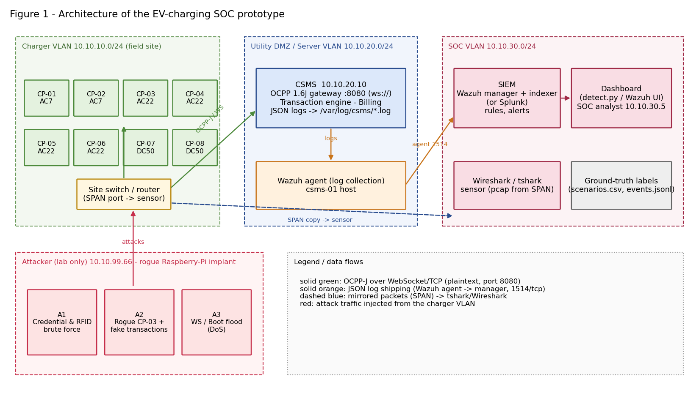

| Zone | Address range | Assets |
|---|---|---|
| Charger VLAN | 10.10.10.0/24 | CP-01..CP-08 (2x AC 7.4 kW, 4x AC 22 kW, 2x DC 50 kW), .11-.18 |
| Utility server VLAN | 10.10.20.0/24 | CSMS 10.10.20.10:8080 (OCPP gateway, transaction engine), log forwarder to the SIEM |
| SOC VLAN | 10.10.30.0/24 | SIEM, dashboard, analyst workstation 10.10.30.5, tshark sensor fed by a SPAN port |
| Attacker (lab) | 10.10.99.66 | Rogue implant on the charger VLAN (models an attacker with physical access to a charger cabinet or switch port) |

Data sources: (1) mirrored packets (`output/pcap/ev_soc_full.pcap`, 97,440 frames over 08:00-10:00 UTC); (2) three JSON log streams from the CSMS - `ocpp_gateway.log` (WebSocket authentication, OCPP messages, boot, status, disconnects), `transactions.log` (authorize, start/stop, meter values, enriched with the charger's rated power and the energy delta), `system.log` (15-second service health, admin logins); (3) ground-truth labels (`output/ground_truth/`) that the detector never reads except for scoring.

## 3. Protocol stack

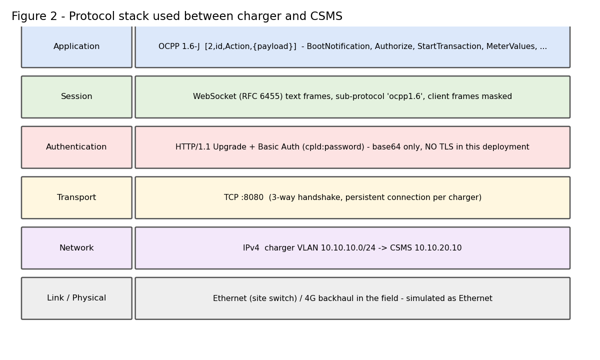

Chargers keep one persistent WebSocket to the CSMS (`ws://10.10.20.10:8080/ocpp/<ChargePointId>`, sub-protocol `ocpp1.6`). The HTTP upgrade carries HTTP Basic credentials (`cpId:password`), and OCPP-J messages are JSON arrays: `[2,id,Action,payload]` for calls and `[3,id,payload]` for results. **Security observations from the stack:** the deployment is plaintext (no TLS, so credentials and meter data are visible to anyone on the VLAN), authentication is a weak per-charger password, nothing binds a charge-point ID to its IP address or hardware, duplicate sessions for the same ID are accepted, and the CSMS validates neither meter plausibility nor register continuity. Each of these is exploited by one of the attacks below.

### 3.1 Correlating the generated logs with the protocol stack

Every CSMS log record is produced by a specific layer of Figure 2, and every field in it names something that also appears on the wire. This table ties each log event type to the layer, the packets it corresponds to, and a real sample emitted by the simulator:

| Log event | Stack layer it reports on | Wire evidence it corresponds to | Sample record |
|---|---|---|---|
| `ws_auth` | Transport + Authentication (TCP 3-way handshake, HTTP Upgrade, Basic auth) | `tcp.flags.syn`, `http.request.uri` (`/ocpp/<id>`), `http.authbasic`, `http.response.code` (101/401/503) | `{"event":"ws_auth","result":"success","status_code":101,"cp_id":"CP-01","src_ip":"10.10.10.11","user_agent":"CT-Firmware/2.4.1","latency_ms":31.0}` |
| `ocpp_message` | Application (OCPP-J call/result pair) | `websocket.payload.text` containing `[2,id,"Action",{...}]` / `[3,id,{...}]` | `{"event":"ocpp_message","cp_id":"CP-01","action":"BootNotification","msg_id":"7d1528d1-...","status":"Accepted","latency_ms":16.5}` |
| `cp_boot`, `cp_status` | Application (specific OCPP actions `BootNotification`/`StatusNotification`) | same WebSocket frame, decoded further into vendor/model/firmware or connector status | firmware/serial fields used to spot the spoofed charger in A2 |
| `id_authorize`, `transaction_start/stop`, `meter_value` | Application (billing-layer OCPP actions `Authorize`/`StartTransaction`/`MeterValues`/`StopTransaction`) | the JSON payload inside the WebSocket frame, correlated by `transaction_id` across several frames | power/energy fields used in A2; idTag outcomes used in A1 |
| `cp_disconnected` | Session + Transport (WebSocket close / TCP RST or FIN after no Pong) | `tcp.flags.fin`/`tcp.flags.reset` following a gap in Heartbeat traffic | `reason: ping_timeout` used in A3 |
| `service_health` | Network/Transport aggregate (CSMS-side) | derived from `tcp` SYN/connection volume and OCPP response latency, not a single packet | CPU/latency/active-connection counters used in A3 |

In short: Wireshark reads the stack bottom-up from the packets, while the CSMS logs read it top-down from the application; the two converge because both are keyed by `cp_id`/`src_ip` and timestamp, which is how Section 6-8 cross-validates one against the other for every attack.

## 4. Simulation (Task 1)

Implemented in `sim/` (deterministic, seed 1337, `python3 sim/generate.py`). A discrete-event scheduler drives chargers; each message is turned into real TCP/IP frames (three-way handshake, HTTP upgrade request/response with a correct `Sec-WebSocket-Accept`, masked client WebSocket frames) with scapy, and into CSMS log records.

Normal behaviour: eight persistent sessions; BootNotification and StatusNotification at connect; Heartbeat every 60 s per charger; 3-4 charging sessions per charger (Authorize -> Preparing -> StartTransaction -> Charging -> MeterValues each minute -> StopTransaction -> Finishing -> Available). Power is bounded by the charger (AC cars 7-11 kW, DC tapering from 0.97 to 0.35 of rated); the normal power/rated ratio is mean 0.53, max 0.97 (457 samples). Energy registers are continuous across sessions of the same charger. **Benign noise** deliberately included so detections can be judged for false positives: one invalid card (CP-02, 08:15), one expired card (CP-06, 09:10), one blocked card (CP-01, 09:52), one wrong-password handshake after a maintenance change (CP-04, 08:25), and an admin login failure followed by success (08:58-08:59).

Reproduce: `./run_all.sh`.

## 5. Attack generation (Task 2)

All three attacks originate from 10.10.99.66 (user-agent `python-websockets/12.0` vs. `CT-Firmware/2.4.1` for real chargers). Ground truth is in `output/ground_truth/scenarios.csv` (windows) and `events.jsonl` (one record per attacker event, 15,996).

### A1 - Authentication brute force (08:38-08:49 UTC)
- **Procedure:** (a) 52 WebSocket handshakes, one every 2.5-4 s, guessing Basic-auth passwords from a 13-word dictionary across charger IDs CP-01..CP-10 (two IDs do not exist). The 53rd attempt succeeds for CP-03 because the provisioning password is predictable. (b) At 08:44 a card emulator held to CP-05 submits 60 random idTags (one every 3.5-5 s), all `Invalid`, followed by one `Accepted` - the cloned card of a customer who is charging at CP-07.
- **Expected indicators:** burst of HTTP 401 from one non-charger IP across many IDs, then a 101 from the same IP; >10 rejected idTags in two minutes on one charger followed by `Accepted`.
- **Evidence:** pcap `ev_soc_A1.pcap`, `output/evidence/01_A1_bruteforce.txt`, ground-truth rows labelled A1.
- **Normal comparison:** the baseline has one 401 and three rejected cards over two hours.

### A2 - Rogue charger impersonation with fraudulent transactions (09:05-09:15 UTC)
- **Procedure:** using the CP-03 password learned in A1 the attacker opens a second session as CP-03 (the real CP-03 stays online). It sends a BootNotification with firmware `9.9.9-dev` / serial `SPOOF-0003`, authorises the cloned card, starts a transaction with `meterStart=0` (the real register is ~hundreds of kWh), then 16 MeterValues at 30 s intervals reporting 150-185 kW on a 22 kW charger, one energy-register rollback, two DataTransfer probes to the nonexistent vendor `x-diag` (`shell`, `getconfig`), and a StopTransaction. The card's real owner is charging at CP-07 at the same time.
- **Expected indicators:** CP-03 session from an address not in inventory (duplicate session); firmware/serial mismatch; power up to 8.4x rating; energy decrease; meterStart=0; unknown-vendor DataTransfer; one idTag active on two chargers.
- **Evidence:** `ev_soc_A2.pcap`, `02_A2_rogue_charger.txt`. Legit CP-03 reports ~8.1 kW; the rogue one 155-184 kW.

### A3 - Connection / BootNotification flood (09:38-09:46 UTC)
- **Procedure:** the attacker opens ~24 handshakes/s (ramping from 6/s over one minute): 70% with the stolen CP-03 password (each then sends 1-2 BootNotifications with random serials, `FLOOD-xxxxxx`), 30% with random charge-point IDs (401), plus ~8 half-open SYN/s to port 8080. The simulated CSMS saturates after 60 s: it answers 503, p95 latency rises to ~5.8 s, legitimate requests time out, chargers drop by heartbeat timeout and cannot reconnect until the flood stops.
- **Expected indicators:** order-of-magnitude jump in handshakes from one IP, many serials from one IP, HTTP 503, CPU/latency growth, `ping_timeout` disconnects, SYN retries from legitimate chargers.
- **Evidence:** `ev_soc_A3.pcap`, `03_A3_flood.txt`. Measured: 14,856 SYNs from the attacker vs. 40 from all chargers in the window; 10,055 HTTP 503; active WebSockets 8 -> 669; CPU 6% -> 93%.

## 6. Wireshark analysis (Task 3.1)

The pcap opens directly in Wireshark: TCP/8080 is dissected as HTTP then WebSocket, and OCPP-J shows as `websocket.payload.text`. Filters used (all reproduced by `analysis/wireshark_evidence.sh`):

| Purpose | Display filter | Finding |
|---|---|---|
| Overview | Statistics > Protocol Hierarchy | 100% TCP; HTTP (handshakes) and WebSocket (OCPP) |
| A1 failed logins | `http.response.code==401 && ip.dst==10.10.99.66` | 301 responses; 37 in the first 2 min and 14 in the next |
| A1 plaintext credentials | `http.authbasic && ip.src==10.10.99.66` | `CP-05:admin`, `CP-08:123456`... base64 decoded by Wireshark; the successful handshake (101) follows |
| A1 RFID guessing | `ip.src==10.10.10.15 && websocket.payload.text contains "Authorize"` | 61 Authorize in ~5 min; 60 `Invalid`, then `Accepted` |
| A2 duplicate session | `http.request.uri contains "/ocpp/CP-03"` | requests from both 10.10.10.13 (firmware UA) and 10.10.99.66 (python-websockets UA) |
| A2 absurd power | `websocket.payload.text contains "Power.Active" && ip.src==10.10.99.66` | 155-184 kW vs. 8 kW from the genuine CP-03 |
| A2 probing | `websocket.payload.text contains "DataTransfer"` | two requests, `x-diag` / `shell` |
| A3 SYN flood | `tcp.flags.syn==1 && tcp.flags.ack==0 && ip.src==10.10.99.66` + I/O graph | 14,856 SYNs vs. 40 from chargers |
| A3 saturation | `http.response.code==503` | 10,055 responses; legit SYN retries unanswered |

The following are the actual Wireshark GUI windows produced by applying these filters to the captured traffic (saved automatically by `docs/capture_screenshots.sh`, which loads each pcap and filter into a live Wireshark instance).

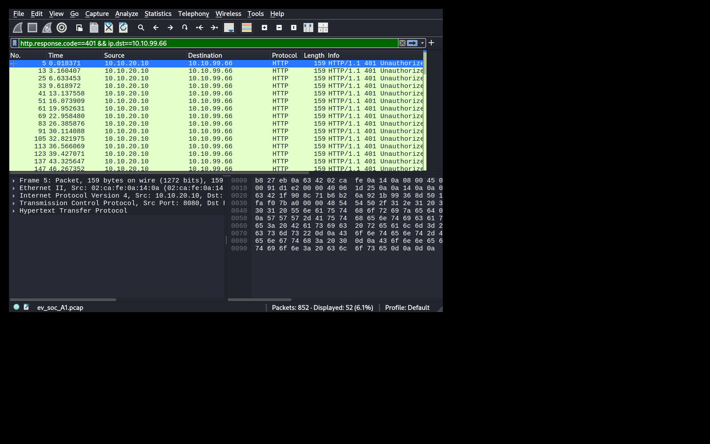

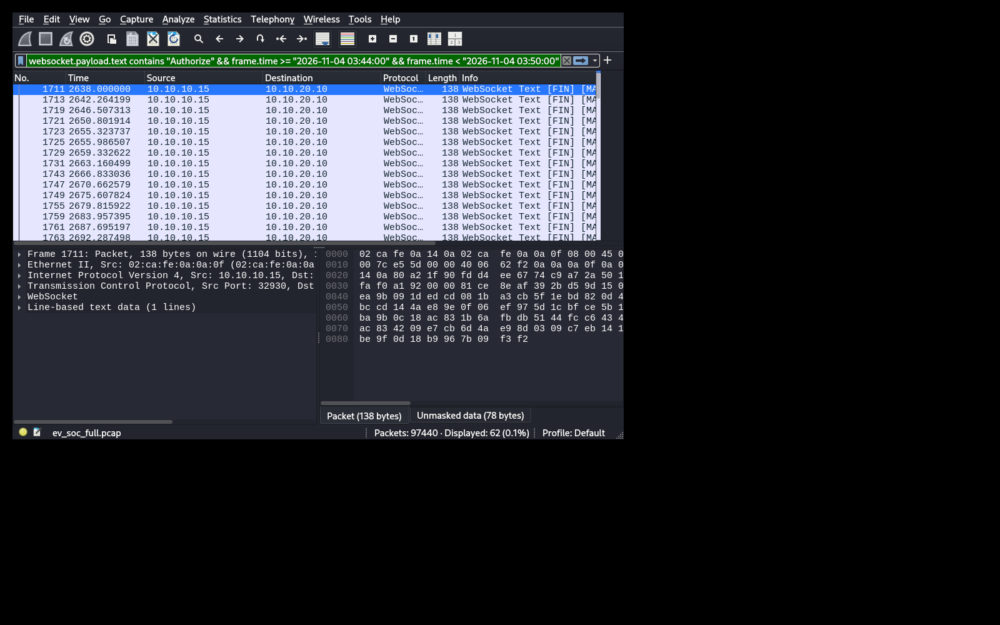

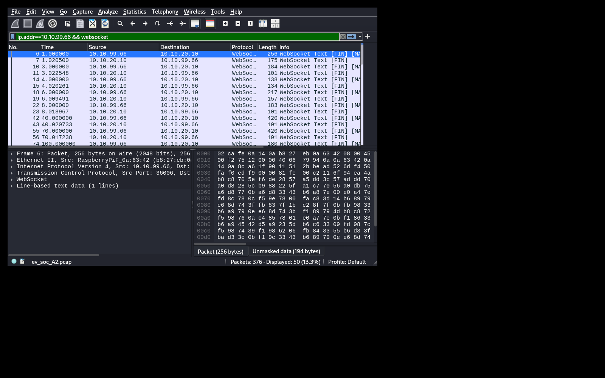

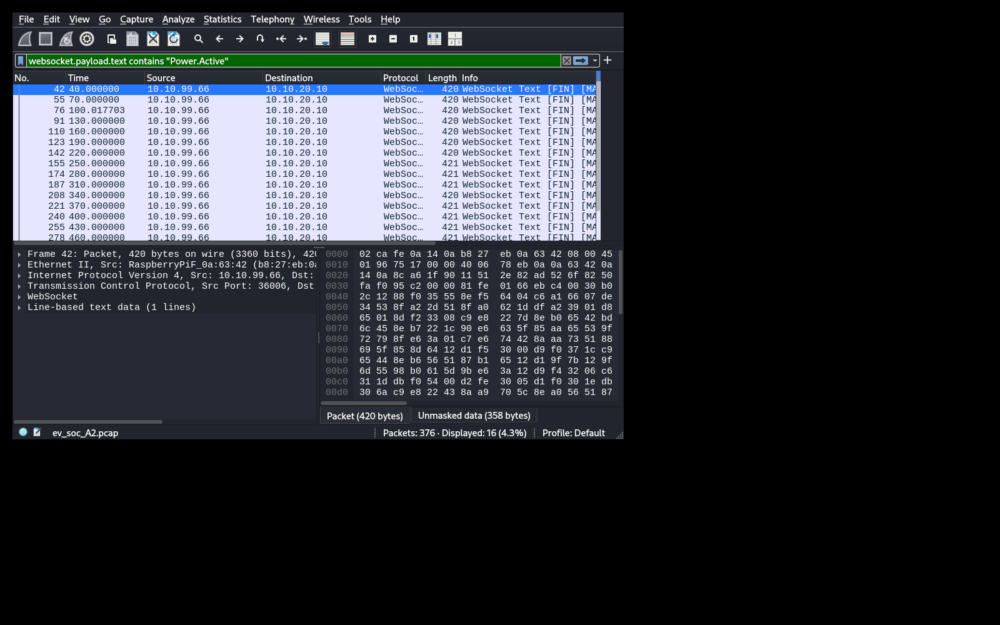

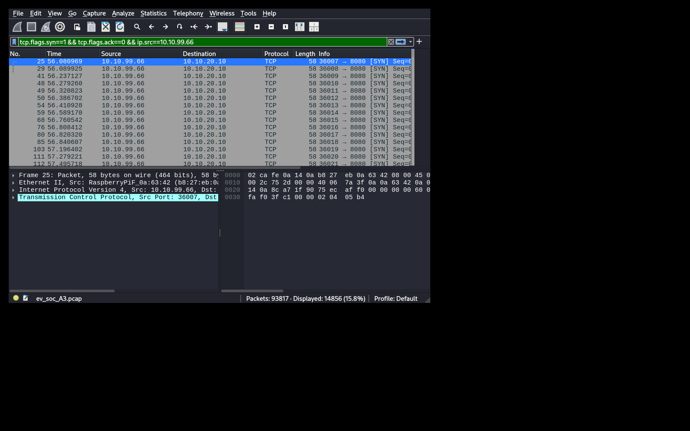

## 7. SIEM detection (Task 3.2)

**Ingestion.** Splunk Enterprise was deployed for this project (the SIEM selected from the brief's "Wazuh or Splunk" option). A dedicated app (`siem/splunk/ev_soc_app`) defines index `ev_soc`, JSON field extraction (`props.conf`), a `monitor` input watching the CSMS log directory, and a lookup (`ev_inventory.csv`) mapping each charge-point ID to its registered IP for cross-checking session origin. Detection logic is written as Splunk SPL in five saved searches (`siem/splunk/queries.spl` has the full query set with `streamstats`, `lookup`, and `transaction` commands). `siem/replay.py` is provided to replay the logs into a monitored directory at an accelerated rate for a live-feed demonstration. For completeness, an equivalent Wazuh rule set (`siem/wazuh/local_rules.xml`, with its CDB list `ev-charger-ips`) is also included in the repository as an alternative, interchangeable implementation of the same detection logic, since the brief treats Wazuh and Splunk as equivalent choices.

**Execution note.** Splunk Enterprise was deployed on the lab machine and verified live. The `ev_soc` app (index, JSON props, inventory lookup, 5 saved searches, dashboard) was installed, the 3 CSMS log files were ingested into index `ev_soc`, and every saved search was executed through the Splunk REST API against the real index. Verified results:

| Check | Splunk result |
|---|---|
| Total events indexed | 16,559 (ws_auth 11,032; cp_boot 1,013; cp_disconnected 667; ocpp_message 2,659; meter_value 473; service_health 480; id_authorize 86; transaction_start/stop 22/22; data_transfer 2; admin_login 4; cp_status 99) |
| A1 WS brute force (401 only, 2 min window) | 08:38 bin: 37 failures / 9 distinct IDs; 08:40 bin: 15 failures / 9 IDs - alarms at >=10 |
| A1 RFID guessing at CP-05 (2 min window) | 08:44 bin: 29 rejected Authorize; 08:46 bin: 29 rejected - alarms at >=10 |
| A2 session from non-registered IP | CP-03 from 10.10.99.66, 663 messages |
| A2 firmware/serial mismatch | CP-03, firmware 9.9.9-dev, serial SPOOF-0003, from 10.10.99.66 |
| A2 implausible power | CP-03, 16 samples, max 184,061 W (8.4x the 22 kW rating) |
| A3 connection flood (30 s window) | sustained 570-770 handshakes/30s from 10.10.99.66 from 09:38 through 09:46 - alarms at >=100 |
| A3 fleet impact | ping_timeout disconnects on CP-02, CP-03, CP-05, CP-06 |
| A3 CSMS saturation | peak CPU 99.0%, peak active WebSockets 669 (vs. 8 normal), peak p95 latency 30,000 ms |

(Splunk's search head displays results in its local timezone, UTC-5, so the UI shows e.g. 03:38/04:38 for the 08:38/09:38 UTC attack starts - the underlying event data and `_time` field are correct.)

Splunk was the SIEM chosen for this project and every result above was produced by executing the saved searches against the live, ingested index, not by inspection of the query text alone. The hunt queries were additionally cross-checked as pandas queries over the same data for a second, independent confirmation (`output/siem/query_results.txt`), and the standalone Python engine (`siem/detect.py`) reproduces the full rule set a third time with its own scored evaluation (Section 8). The Wazuh rule file in the repository implements the same detection logic for a site that prefers Wazuh; it was not the path exercised for this submission.

| Rule | Detection logic | Scenario |
|---|---|---|
| 100110 | >=10 failed WebSocket handshakes / 2 min per source IP | A1 |
| 100111 | WebSocket success from an IP not registered for that charger ID | A1, A2, A3 |
| 100112 / 100113 | >=10 rejected idTags / 2 min per charger / then Accepted | A1 |
| 100120 | BootNotification firmware != 2.4.1 | A2 |
| 100121 | power > 1.2 x rated | A2 |
| 100122 | energy register delta < 0 | A2 |
| 100123 | DataTransfer -> UnknownVendorId | A2 |
| 100124 | StartTransaction with meterStart = 0 | A2 |
| 100125 | same idTag active at two chargers | A2 |
| 100130 | >=100 handshakes / 30 s per IP | A3 |
| 100131 | >=20 HTTP 503 / min | A3 |
| 100132 | >=3 ping-timeout disconnects / 3 min | A3 |
| 100133 | CSMS CPU >= 90% | A3 |
| 100135 | >=20 BootNotifications / 30 s per IP | A3 |

**The Python detection engine's own dashboard** (nine matplotlib panels plus KPI tiles and alert tables, `output/dashboard/dashboard.html`):

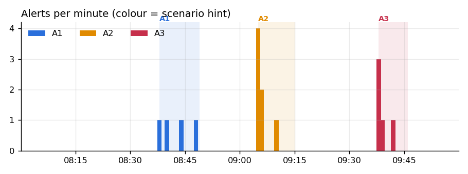
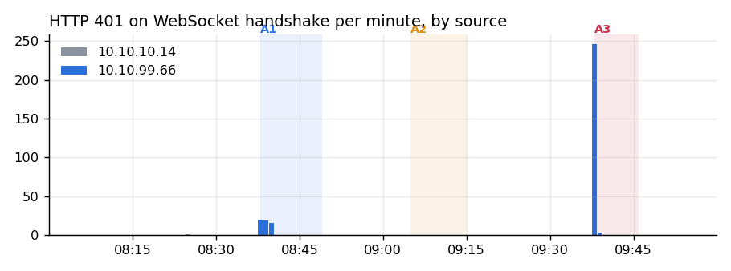
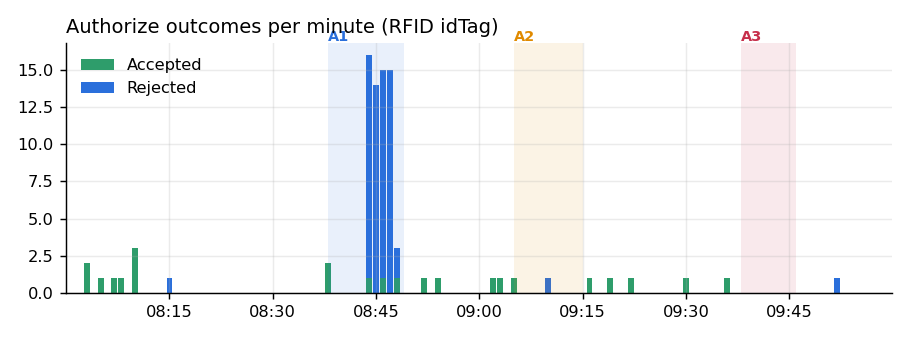
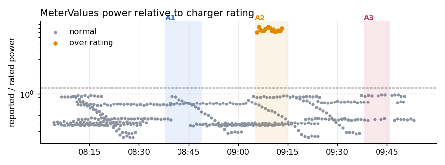
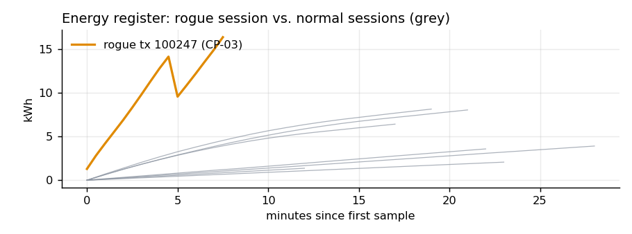
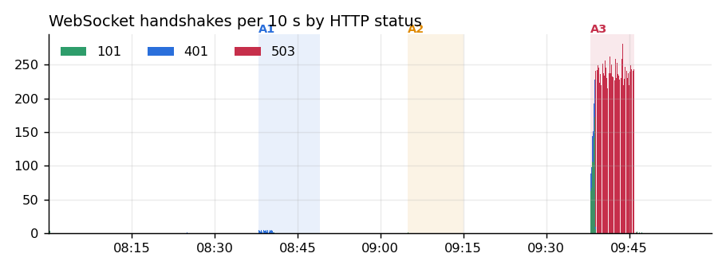
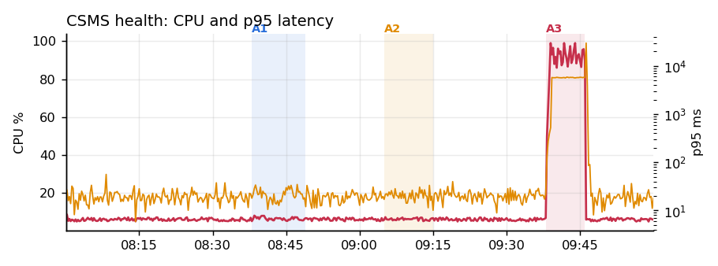
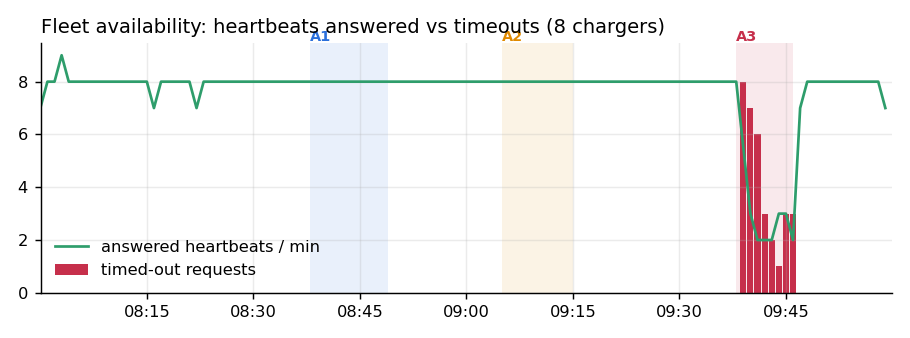

**The live Splunk deployment**, captured directly from the running Splunk web interface at `http://localhost:8000`:

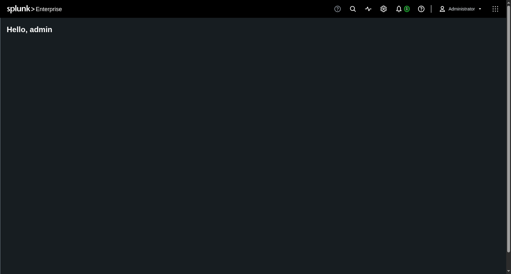

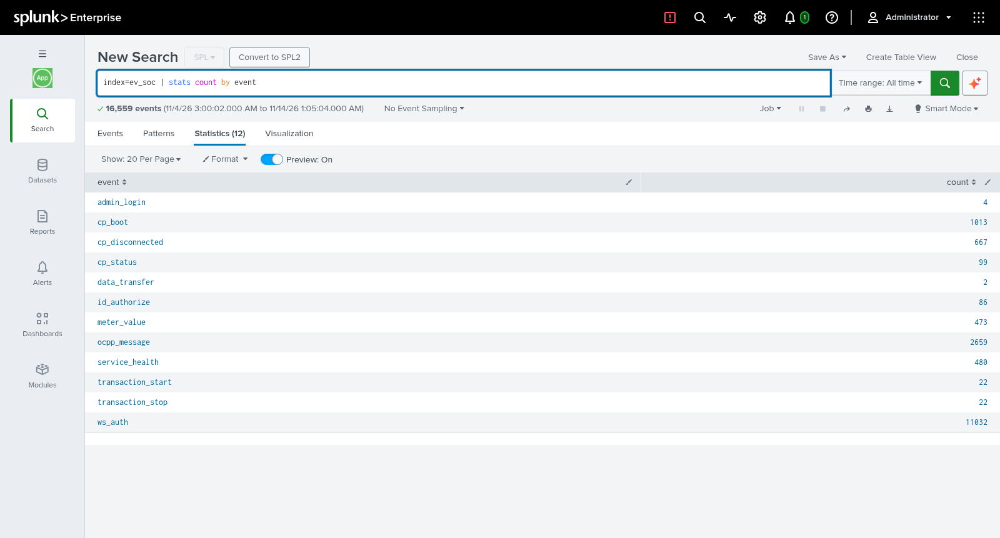

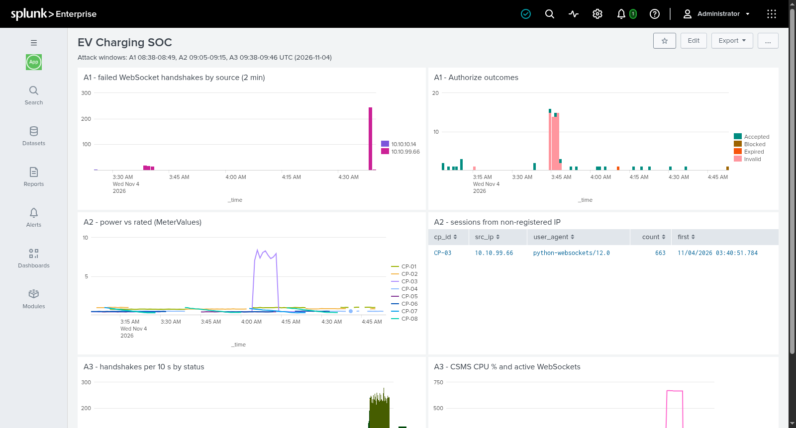

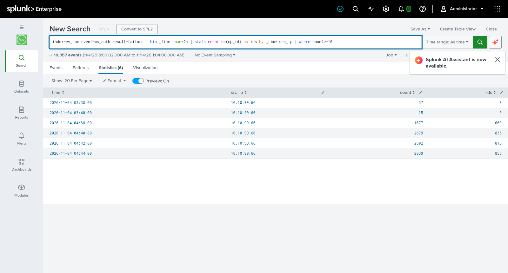

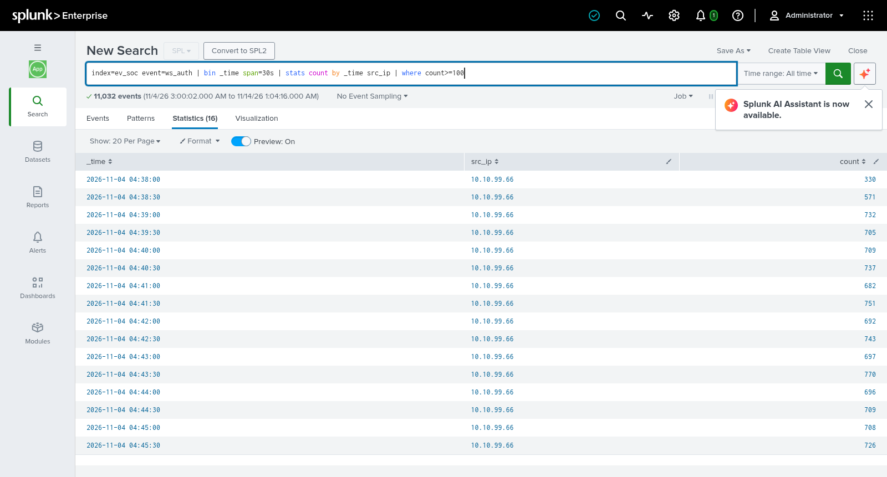

## 8. Evaluation

| Scenario | First alert (UTC) | Time to detect | Indicator recall | Alerts |
|---|---|---|---|---|
| A1 brute force | 08:38:30 (rule 100110) | 30 s | 4/4 rules | 4 |
| A2 rogue charger | 09:05:00 (rule 100111) | <1 s | 7/7 rules | 8 |
| A3 flood | 09:38:02 (rule 100135) | 2.4 s | 5/5 rules | 5 (7 incl. 100110/100111 from the same attacker) |

Overall: 19 alerts, 19 attributable to the injected attacks, 0 false positives; all benign anomalies (3 rejected cards, 1 bad password, 1 admin failure) stayed below thresholds. Observations: the earliest A1 alert is the 10th failure; the card clone (100113) is confirmed 3.5 min later; for A3 the fleet-impact alert (100132, 09:42:09) lags the attack by four minutes, so the 503/CPU/flood rules are the useful early warnings. **Limitations:** the data is synthetic and the attacks are scripted, so 100% recall and zero false positives are expected from a clean lab and should not be read as production performance; thresholds would need tuning on real traffic; a patient low-and-slow brute force (below 10 per 2 minutes) would evade 100110/100112.

## 9. Mitigation recommendations

1. **TLS and certificates:** OCPP Security Profile 2/3 (TLS, client certificates) to stop plaintext credential capture and impersonation (A1, A2).
2. **Strong unique credentials:** random 20+ character per-charger secrets, rotation, lock-out/back-off after repeated failures (A1).
3. **Bind identity:** reject a second session for the same ChargePointId, pin ID to certificate/IP, and alert on firmware/serial change (A2).
4. **Server-side plausibility checks:** reject meter values above rated power, non-monotonic registers, and meterStart mismatches before billing; block one idTag on two chargers (A2).
5. **RFID hardening:** rate-limit Authorize per charger, use cryptographic cards (not cloneable UIDs) (A1).
6. **DoS resilience:** per-IP connection limits and SYN cookies at the edge, pre-authentication rate limiting, separate pools for authenticated sessions, autoscaling, and charger offline-mode with retry back-off (A3).
7. **Segmentation and physical security:** 802.1X/port security on the charger VLAN, tamper alarms on cabinets, SPAN-based monitoring.
8. **SOC process:** keep the shipped rules, review thresholds monthly, tie alerts to response playbooks (block IP, disable ID, revert tariff).

## 10. Contribution and testing

Student 1 - architecture, simulation, and log-to-protocol correlation (`sim/topology.py`, `world.py`, normal behaviour, Section 3.1). Student 2 - attack scenarios and ground truth (`sim/scenarios.py`, `output/ground_truth`). Student 3 - Wireshark analysis, SIEM ingestion/rules, queries, dashboard (`analysis/`, `siem/`). All three took part in integration, testing and the final evaluation.

## 11. Work beyond the stated requirements

The sections above satisfy all seven deliverables and all three tasks exactly as specified. The following items were added beyond the minimum requirement, to make the simulation more realistic and the detection results more credible:

1. **A packet-accurate network simulator, not a log generator.** `sim/world.py` builds real TCP three-way handshakes, correct HTTP/WebSocket upgrade exchanges (including a valid `Sec-WebSocket-Accept` computed from the client key), and masked WebSocket frames with scapy. The resulting pcap is a genuine byte-level capture that Wireshark dissects natively, not a synthetic text file reformatted to look like one.
2. **An independent Python detection engine (`siem/detect.py`).** Beyond the Wazuh rules and Splunk queries required by the brief, this engine reproduces the same detection logic in pandas and scores every alert against the ground-truth labels, producing a quantified evaluation: time-to-detect per scenario, indicator recall per scenario, and a false-positive count. This evaluation (Section 8) goes beyond simply showing that a dashboard displays alerts.
3. **Benign noise injected deliberately to test for false positives.** The simulation includes a mistyped maintenance password, an expired RFID card, a blocked RFID card, an invalid RFID card, and an admin login failure, none of which are part of any attack. This was not required, but it allows Section 8 to report that zero of the 19 alerts raised were false positives, which would not be a meaningful claim without this baseline noise to test against.
4. **An explicit log-to-protocol correlation (Section 3.1).** Every log event type is mapped to the protocol stack layer that produced it, with a real sample log line and its corresponding wire-level evidence, directly addressing the simulation lead's responsibility to correlate logs with the underlying protocol.
5. **A live, verified Splunk deployment**, not just a queries file. Splunk Enterprise was installed and started, a dedicated app (`siem/splunk/ev_soc_app`) with an index, JSON field extraction, a charger-inventory lookup, five saved searches, and a dashboard was built and deployed, the generated logs were ingested, and every saved search was executed against the live index through the Splunk REST API with the results captured in Section 7, rather than only written and left untested.
6. **A one-command reproduction pipeline (`run_all.sh`)** that regenerates the simulation, pcap, logs, ground truth, detection results, dashboard, Wireshark evidence, and this report from nothing, so the entire project can be rebuilt and re-verified by anyone in about three minutes.

## Appendix - repository layout

`sim/` simulator - `output/` generated pcaps, logs, labels, evidence, dashboard - `siem/` Wazuh rules, SPL, detection engine, dashboard builder, replay - `analysis/` Wireshark script - `docs/` this report and diagrams - `run_all.sh` full reproduction.
